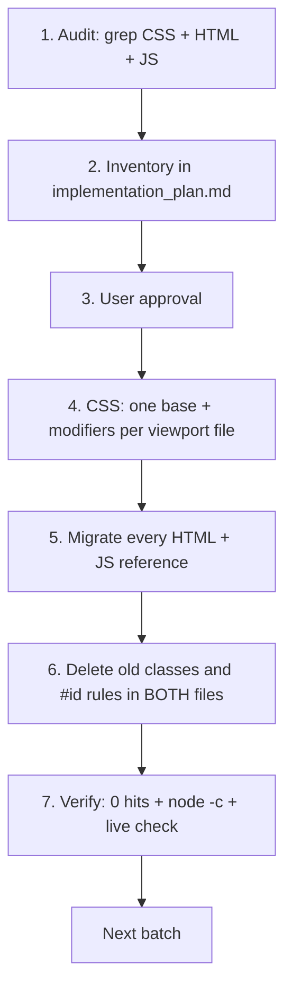

# OOCSS Refactor Protocol (IVIDS)

This skill executes the **CSS Class Reuse Contract** in [AGENTS.md §4](file:///c:/Users/kenji/AndroidStudioProjects/IVIDS/.agents/AGENTS.md). Read §4 first; this skill is the procedure, §4 is the law.

**Goal**: every component that looks and behaves the same uses the SAME classes in HTML and JS, is styled ONCE per viewport file, and all old page-specific classes / `#id` rules are deleted.

---

## 1. Ground Rules

| Rule | Meaning |
| :--- | :--- |
| **Same component = same class** | Hero play, Details play and Login submit are all `btn btn--primary` with `btn__icon` + `btn__label`. Never `.details-play-btn` or `#play-btn {}`. |
| **Name by WHAT, never WHERE** | `.empty-state`, not `.playlists-empty-state`; `.badge`, not `.update-version-badge`; `.page-title`, not `.settings-header h1`. |
| **IDs are JS hooks only** | No `#id { ... }` styling rules. |
| **Two files, two skins, one class name** | `global.css` = Landscape / Desktop / TV skin. `global-mobile.css` = Mobile portrait skin. Same class names, intentionally different looks (e.g. `.btn--primary` translucent green on TV, solid white on mobile). NEVER merge, copy or "unify" skins across the two files. |
| **Unify within a file** | Inside one file, components that share a look share ONE grouped base selector; modifiers hold only differences. |
| **No context overrides** | No `.modal__footer .btn`, `.login-panel .form-input`. Use a modifier (`.btn--block`) or a container object (`.btn-group--fill`). |
| **Icons follow text** | Icons are masks with `background-color: currentColor`; states change `color` on the component only. |
| **TV standards** | Every interactive element keeps `focusable`; focus = white border `#ffffff`; no `scale`/`translate` on hover/focus; no inline styles; no `!important` unless overriding external player markup. |

---

## 2. The 5 OOCSS Layers

| Layer | Holds | Naming | Example |
| :--- | :--- | :--- | :--- |
| **Base** | Everything shared: display, alignment, padding, radius, typography, background, border, transitions | `.<component>` | `.btn`, `.card`, `.badge` |
| **Elements** | Fixed children of the component | `.<component>__<part>` | `.btn__icon`, `.btn__label`, `.modal__title` |
| **Modifiers** | ONLY the properties that differ (size, shape, skin) | `.<component>--<variant>` | `.btn--sm`, `.btn--circle`, `.btn--primary` |
| **States** | Interaction state, in order `default → active → hover → focus` | `:hover`, `:focus`, `.focused`, `.is-active` | `.btn--primary:focus, .btn--primary.focused` |
| **Containers** | Layout of children, never restyle children | `.<component>-<layout>` | `.btn-group`, `.btn-group--fill` |

---

## 3. Procedure (one component family per batch)



### Step 1 — Audit (zero omissions)
1. In `app/src/main/assets/main/gui/css/global.css` AND `global-mobile.css`, grep every class, `#id` rule and descendant override for the component family (e.g. everything that styles a play/primary button, icon, title, badge, row).
2. Grep all `.html` (`gui/`, `gui/pages/`, `gui/components/`) and all `.js` (`gui/pages/`, `gui/js/`, `main/logic/`) for those names, including template literals, `className`, `classList` and `querySelector` strings.
3. Group findings into: **duplicates of an existing base** (migrate), **true variants** (become a modifier), **truly new component** (new generic base — rare, must be justified).

### Step 2 — Inventory in the plan
List every class/selector to delete, every file + line to migrate, and the target classes. Counts must match the grep results. Anything discovered later means the audit was incomplete — re-run Step 1 for that family.

### Step 3 — User approval
Large batches (5+ files) need approval per the global complexity rules before editing.

### Step 4 — CSS
1. Reuse the base from the catalog in AGENTS.md §4.5. Add a modifier only for real differences.
2. Write the landscape skin once in `global.css` and, if mobile differs, the mobile skin once in `global-mobile.css` — same class names.
3. Group identical bases into one selector list instead of repeating declarations.
4. One-line comment above every new/changed rule; new base classes list their consumers.

### Step 5 — Migrate markup
Update every HTML template and JS renderer from the inventory to the shared classes. Keep `focusable`, ids used by JS, `data-i18n` and ARIA attributes. Update any JS `querySelector('.old-class')` to the new class.

### Step 6 — Delete
Remove the old classes, `#id` style rules, context overrides and duplicate blocks from BOTH CSS files. Do not delete a legacy alias while any `.html`/`.js` still references it.

### Step 7 — Verify
- [ ] Repo-wide grep (`.html`, `.js`, `.css`) returns **0 hits** for every removed name.
- [ ] `node -c` passes on every modified `.js` file.
- [ ] No new page-prefixed class or `#id` rule was introduced; any new class is named and justified in the response.
- [ ] Landscape (`1280x720`) and mobile (`390x844`) still show their OWN skins; D-pad focus shows the white border.
- [ ] `task.md` updated.

---

## 4. Batch Roadmap

1. **Buttons** — `.btn` skins/sizes, `.btn__icon`, `.btn__label`, round back/refresh/retry buttons (`.btn--circle`).
2. **Headings** — `.title-hero`, `.page-title`, `.section-title`, `.section-subtitle`, `.modal__title`.
3. **List & selection rows** — settings, language, provider, app-info, Live TV rows (one row base per viewport file).
4. **Forms & search** — `.form-control-wrapper`, `.form-input`, `.form-select`, tab bars.
5. **Badges & empty/error states** — `.badge` (+ modifiers), `.empty-state` + `.empty-state__text`.
6. **Cards, grids, rails & modals** — `.card--*`, `.media-grid--*`, `.media-rail`, `.modal__*`.
7. **Tokens** — font sizes, radii (`--radius-*` landscape, `--mobile-radius-*` mobile), weights.

---

## 5. Example — Play buttons

**Before** (three components that are really one):
```html
<button id="play-btn" class="play-icon-button focusable"><span class="mobile-play-icon"></span><span class="play-button-label">Play</span></button>
<button id="details-play" class="details-play-icon-btn focusable"><span class="details-play-icon"></span><span class="details-play-label">Play</span></button>
```
```css
#play-btn { height: 48px; font-size: 15px; border-radius: 12px; }
#details-play { min-height: 48px; font-size: 14px; border-radius: 12px; }
```

**After** (one component, two viewport skins):
```html
<button id="play-btn" class="btn btn--primary focusable"><span class="btn__icon"></span><span class="btn__label" data-i18n="common.play"></span></button>
<button id="details-play" class="btn btn--primary focusable"><span class="btn__icon"></span><span class="btn__label" data-i18n="common.play"></span></button>
```
```css
/* global.css — Landscape/TV primary button skin: translucent brand green, white focus border. */
.btn--primary { background: rgba(var(--primary-rgb), 0.25); color: #ffffff; }
.btn--primary:focus, .btn--primary.focused { background: rgba(var(--primary-rgb), 0.35); border-color: #ffffff; outline: none; }

/* global-mobile.css — Mobile primary button skin: solid white with dark text. */
#app .btn--primary, body .modal .btn--primary { background: #ffffff; border: 1px solid #ffffff; color: var(--mobile-ink); }
```
Then delete `.play-icon-button`, `.mobile-play-icon`, `.play-button-label`, `.details-play-*`, `#play-btn {}` and `#details-play {}` from both files and confirm 0 hits.
