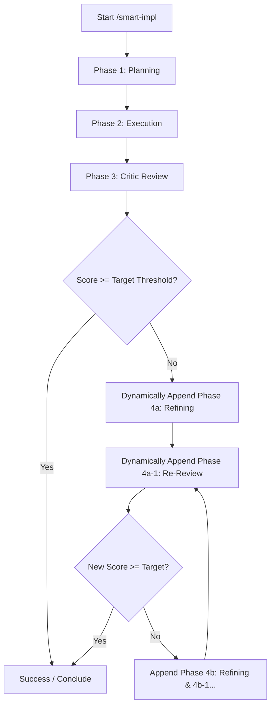

# Smart Implementation Skill (`/smart-impl`)

This skill defines the standardized, multi-phase execution protocol for smart feature implementations, architectural refactors, and critical bug fixes in the IVIDS codebase.

---

## 📋 Protocol Overview & State Machine

When activated, this workflow enforces a strict 3-phase baseline, followed by a **conditional iterative refinement loop** (Phase 4) if the quality score threshold is not met:



---

## 🛠️ Step-by-Step Instructions

### Step 0: Initialize Overview Artifact (`task.md`)

Before doing any work, the agent **MUST** create or update the overview task list artifact (`task.md`).

> [!IMPORTANT]
> **Dynamic Step 4 Invariant**: The overview artifact MUST initially contain **ONLY** Steps 1, 2, and 3. Do **NOT** write Step 4 into the initial task list. Step 4 is strictly conditional and is only appended if Phase 3 produces a score below the required threshold.

**Initial `task.md` Template:**
```markdown
# Implementation Overview: [Feature / Task Name]

- **Target Score Threshold**: [e.g. 18/20 (90%) or User Specified Value]
- **Current Status**: Phase 1: Planning in progress

## Steps
- [ ] 1. Planning (Formulate implementation plan artifact)
- [ ] 2. Execution (Implement verified code changes)
- [ ] 3. Critic Review (Multi-category evaluation & score /20)
```

---

### Step 1: Planning (`1. Planning`)

1. **Rigorous Pre-Planning Verification**:
   - Inspect live codebase files, native bridges, and relevant styles.
   - Zero speculation: verify exact parameters, function signatures, and selectors.
2. **Implementation Plan Artifact (`implementation_plan.md`)**:
   - Create a dedicated plan artifact using standard OOP principles (encapsulation, single responsibility).
   - Include mandatory Mermaid diagrams:
     - `mermaid classDiagram` for class structures and relationships.
     - `mermaid sequenceDiagram` for method invocations, event propagation, and native bridge communications.
   - List touched files, affected systems, and validation commands.
3. **Update Overview Artifact**:
   - Mark `[x] 1. Planning` as complete.
   - Update `Current Status` to `Phase 1 completed, awaiting execution`.

---

### Step 2: Execution (`2. Execution`)

1. **User Confirmation Check**:
   - If the user explicitly requested confirmation before changes, or if the changes involve high-impact architectural modifications, present a brief summary and request confirmation to proceed.
   - If user provided upfront approval (e.g. "ga meteen door"), proceed directly.
2. **Execute File Modifications**:
   - Use direct native file editing tools (`edit_file`, `write_file`) only.
   - Never use temporary scratch scripts to modify application source code.
   - Adhere strictly to project rules:
     - OOCSS component architecture and design tokens (`global.css`).
     - Spatial navigation compatibility: all interactive elements must have `.focusable` and `tabIndex = 0`.
     - Zero forbidden hover/focus displacements (`translateX`, `translateY`, `scale`).
     - Strict i18n: no hardcoded strings in HTML or JS.
     - 1-2 sentence documentation block (JSDoc/Docstring) above every new/modified function.
3. **Syntax & Quality Validation**:
   - Run syntax validation (e.g. `node -c <file>` for JavaScript).
   - Ensure zero syntax errors and zero broken imports.
4. **Update Overview Artifact**:
   - Mark `[x] 2. Execution` as complete.
   - Update `Current Status` to `Phase 2 completed, starting Critic review`.

---

### Step 3: Critic Review (`3. Critic Review`)

1. **Determine Target Requirement Threshold**:
   - Parse the user's prompt for target thresholds:
     - Fraction (e.g. `9/10` -> `18/20`, `9.5/10` -> `19/20`).
     - Percentage (e.g. `90%` -> `18/20`, `85%` -> `17/20`).
     - Direct score (e.g. `18/20`).
     - **Default Threshold**: If not specified by the user, default to **18/20 (90%)**.
2. **Launch Critic Subagent**:
   - Invoke a research subagent (`Role: Implementation Critic`, `TypeName: research`).
   - The Critic must evaluate the work against 5 standardized categories (4 points each, total 20 points):
     1. **Functional Correctness & Scope Compliance** (0–4 pts): Implements all requested behaviors without skipping details or adding unrequested bloat.
     2. **Code Quality & Architecture Standards** (0–4 pts): Adheres to OOP principles, OOCSS guidelines, JSDoc comments, clean separation of concerns.
     3. **Cross-Platform Compatibility & Spatial Nav** (0–4 pts): Validated for Desktop, Android TV (D-pad focus visibility, `.focusable`, history/back handling), and Mobile touch/portrait.
     4. **Resilience, Edge Cases & Error Handling** (0–4 pts): Handles null values, missing assets, network drops, modal trapping, and state cleanup.
     5. **Syntax, Verification & Documentation** (0–4 pts): Free of syntax errors, verified via direct inspection, docstrings complete.
3. **Process Critic Score**:
   - Extract the overall score out of 20 and itemized feedback list.
   - Record score in `task.md`.

---

### Step 4: Conditional Refinement Loop (Triggered ONLY if Score < Target Threshold)

If the Critic's score is **lower than the target threshold**:

1. **Dynamically Update Overview Artifact (`task.md`)**:
   Append sub-step `4a. Refining` and `4a-1. Reviewing`:
   ```markdown
   - [ ] 4a. Refining (Address Critic deficiencies: [summary of issues])
   - [ ] 4a-1. Reviewing (Critic re-evaluation)
   ```
2. **Execute Phase 4a (Refining)**:
   - Fix each failed item and deficiency identified in the Critic's report.
   - Validate syntax and test the changes.
   - Mark `[x] 4a. Refining` complete in `task.md`.
3. **Execute Phase 4a-1 (Reviewing)**:
   - Spawn a fresh Critic subagent to re-evaluate the revised code.
   - Obtain the updated score out of 20.
   - Mark `[x] 4a-1. Reviewing` complete in `task.md`.
4. **Evaluate Next Iteration**:
   - If the new score is **>= Target Threshold**: Conclude successfully.
   - If the new score is **still < Target Threshold**:
     - Dynamically append `4b. Refining` and `4b-1. Reviewing` to `task.md`.
     - Repeat the cycle until the score meets or exceeds the target threshold.

---

## 🎯 Completion & Reporting

Once the target threshold is met:
1. Update `task.md` marking the workflow fully complete:
   ```markdown
   - **Current Status**: Complete - Quality Target Met ([Final Score]/20 vs Target [Target Score]/20)
   ```
2. Present a short, concise summary to the user:
   - Confirmed score out of 20.
   - Key categories verified.
   - Completed touches and next available actions.
