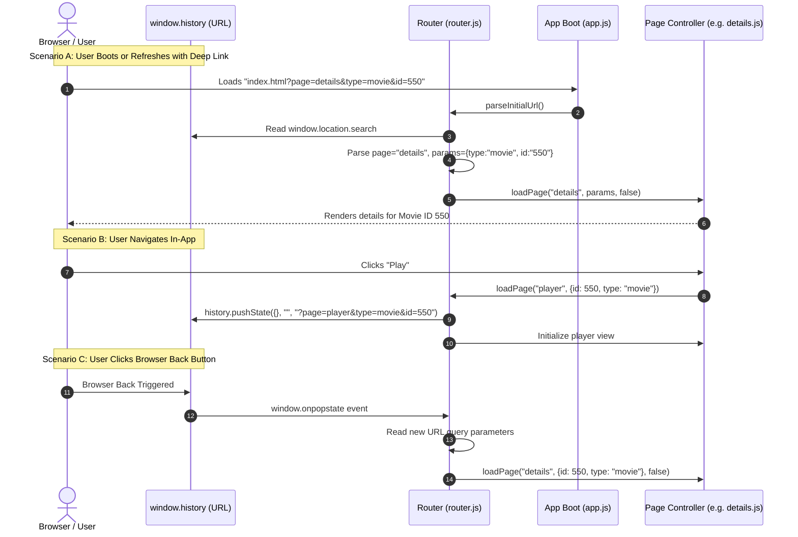

# Deep-Linking & URL Query-Parameter Routing Architecture (Future Proposal)

## 1. Executive Summary & Goals

Currently, IVIDS operates as a Single-Page Application (SPA) where view changes are managed strictly in memory via `Router.loadPage(pageName, params)`. The browser URL remains static (e.g. `http://localhost:8000/index.html`). 

### Key Problems with Static SPA URLs:
1. **No Refresh Persistence**: Refreshing the browser (F5 or browser reload) causes the application to reset to the default boot page (`home` or `login`), losing the active movie details, search query, or playback state.
2. **No Bookmarkability / Link Sharing**: Users cannot bookmark or share links to specific movies, series, or playlists.
3. **Browser History Disconnect**: Browser native forward/back navigation buttons are out of sync with internal route history.

### Solution:
Implement a query-parameter deep-linking system:
- Format: `http://localhost:8000/index.html?page=[route]&[params...]`
- Example Home: `http://localhost:8000/index.html?page=home`
- Example Movie Details: `http://localhost:8000/index.html?page=details&type=movie&id=550`
- Example Series Episode: `http://localhost:8000/index.html?page=player&type=tv&id=1399&season=1&episode=1`

> [!NOTE]
> Why Query Parameters (`?page=...`) instead of path segments (`/details/550`)?
> Local static dev servers (e.g. `py -m http.server`), Android WebView (`file:///android_asset/main/gui/index.html`), and Tizen Web run without an active URL-rewrite engine (such as nginx `try_files` or Apache `mod_rewrite`). A path like `/details/550` throws an immediate HTTP 404 on reload, whereas `index.html?page=details&id=550` safely loads `index.html` on any host or local file system.

---

## 2. Deep-Link URL Parameter Matrix

| Route | Example URL | Query Parameters Handled | Purpose / Restored State |
| :--- | :--- | :--- | :--- |
| **Home** | `index.html?page=home` | None | Default landing dashboard |
| **Movies** | `index.html?page=movies` | None | Movies browse view |
| **Series** | `index.html?page=series` | None | TV Series browse view |
| **Details (Movie)** | `index.html?page=details&type=movie&id=550` | `type`, `id` | Opens movie backdrop, metadata, trailer & playlist button |
| **Details (TV)** | `index.html?page=details&type=tv&id=1399` | `type`, `id`, `season` *(optional)* | Opens TV show metadata, seasons list & episodes |
| **Search** | `index.html?page=search&query=Batman` | `query`, `genreId`, `type` | Restores search results or filtered genre grid |
| **Player (VOD)** | `index.html?page=player&type=movie&id=550` | `type`, `id`, `season`, `episode`, `t` | Opens player and resumes playback at timestamp `t` |
| **Live TV** | `index.html?page=livetv&channel=12` | `channel` *(optional)* | Focuses/opens specified channel in EPG |
| **Playlists** | `index.html?page=playlists` | None | Custom user playlists overview |
| **Playlist Details** | `index.html?page=playlist-details&id=favs_1` | `id` | Opens specific user playlist by ID |
| **Settings** | `index.html?page=settings` | None | Settings and preferences panel |
| **Account** | `index.html?page=account` | None | Profile selection and manager |

---

## 3. Architecture & Synchronization Flow



---

## 4. Implementation Design Details

### 4.1. URL Serializer & Deserializer in `router.js`

```javascript
export const Router = {
    // ... existing properties ...

    /**
     * Converts a route name and parameter dictionary into a standard query string.
     * @param {string} pageName - The page identifier (e.g. 'details').
     * @param {Object} params - The parameter key-value pairs.
     * @returns {string} Serialized query string (e.g. '?page=details&type=movie&id=550').
     */
    buildQueryString(pageName, params = {}) {
        const queryParams = new URLSearchParams();
        queryParams.set('page', pageName);

        for (const [key, value] of Object.entries(params)) {
            if (value !== undefined && value !== null && value !== '') {
                queryParams.set(key, String(value));
            }
        }
        return `?${queryParams.toString()}`;
    },

    /**
     * Parses the current browser URL query parameters into route name and params object.
     * @returns {{ page: string, params: Object }}
     */
    parseCurrentUrl() {
        const search = window.location.search;
        if (!search) {
            return { page: 'home', params: {} };
        }

        const queryParams = new URLSearchParams(search);
        const page = queryParams.get('page') || 'home';
        const params = {};

        for (const [key, value] of queryParams.entries()) {
            if (key !== 'page') {
                params[key] = value;
            }
        }
        return { page, params };
    },

    /**
     * Synchronizes browser URL bar without triggering a full page reload.
     * @param {string} pageName - The route name.
     * @param {Object} params - The route parameters.
     * @param {boolean} replace - Whether to replace the current history entry or push a new one.
     */
    syncUrl(pageName, params = {}, replace = false) {
        // Skip for Cordova/file:// environments if pushState is restricted
        if (window.location.protocol === 'file:') return;

        const newUrl = `${window.location.pathname}${this.buildQueryString(pageName, params)}`;
        if (replace) {
            window.history.replaceState({ page: pageName, params }, '', newUrl);
        } else {
            window.history.pushState({ page: pageName, params }, '', newUrl);
        }
    }
};
```

### 4.2. Boot Integration in `app.js`

On initial boot inside `app.js`:
```javascript
// Replace hardcoded Router.loadPage('home') with initial URL parser
const initialRoute = Router.parseCurrentUrl();
Router.loadPage(initialRoute.page, initialRoute.params, false);

// Bind browser back/forward buttons
window.addEventListener('popstate', (e) => {
    if (e.state && e.state.page) {
        Router.loadPage(e.state.page, e.state.params, false);
    } else {
        const currentRoute = Router.parseCurrentUrl();
        Router.loadPage(currentRoute.page, currentRoute.params, false);
    }
});
```

### 4.3. Navigation Integration in `Router.loadPage`

Whenever `Router.loadPage(pageName, params, addToHistory)` is called:
```javascript
if (addToHistory) {
    this.syncUrl(pageName, params, false);
} else {
    this.syncUrl(pageName, params, true);
}
```

---

## 5. Benefits & Safety Guardrails

1. **100% Platform Safety**: Because query parameters preserve `index.html`, this works identically across:
   - Node/Python dev server (`http://localhost:8000/index.html?page=details&id=123`)
   - Production web servers without URL rewrite configuration.
   - Gracefully ignores `window.history.pushState` on `file://` / Android APK if restricted.
2. **Deep-Link Recovery**: If a user is on `details&type=tv&id=1399` and hits reload, TMDB details, episodes, and seasons fetch cleanly and restore the exact view without sending the user back to Home.
3. **No Page Redirection Lag**: Utilizes `pushState`, which updates the address bar instantaneously in 0ms with zero network overhead.

